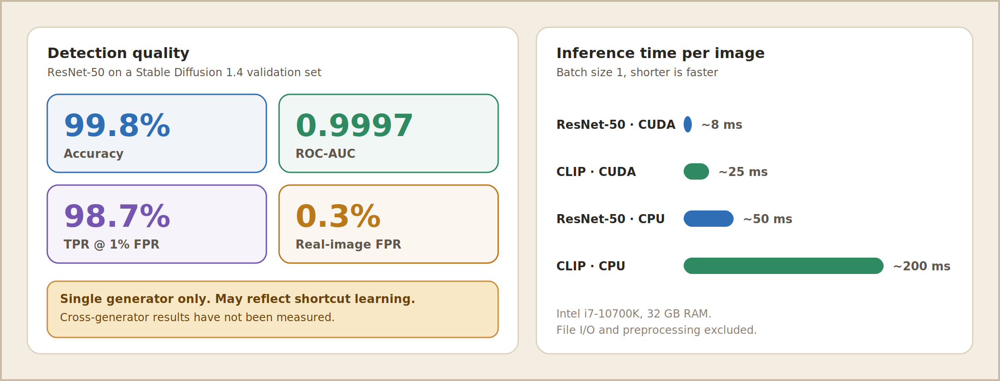

<a id="top"></a>

<p align="center">
  
</p>

<p align="center">
  
  
  
  
  
</p>

<h3 align="center">Detect AI-generated images with two independent models,<br>then let humans decide what becomes training data.</h3>

<p align="center">
  <a href="#how-it-works">How it works</a> ·
  <a href="#quick-start">Quick start</a> ·
  <a href="#using-the-ui">UI</a> ·
  <a href="#architecture">Architecture</a> ·
  <a href="#models">Models</a> ·
  <a href="#api">API</a> ·
  <a href="#human-in-the-loop">Human-in-the-loop</a> ·
  <a href="#datasets">Datasets</a> ·
  <a href="#training">Training</a> ·
  <a href="#performance">Performance</a> ·
  <a href="#troubleshooting">Troubleshooting</a>
</p>

<table align="center">
  <tr>
    <td align="center" width="25%"><h3>🧠 2</h3><b>Independent models</b><br><sub>ResNet-50 and CLIP ViT-L/14</sub></td>
    <td align="center" width="25%"><h3>👤 Human</h3><b>Verified labels</b><br><sub>predictions never overwrite them</sub></td>
    <td align="center" width="25%"><h3>🗂️ Versioned</h3><b>Datasets</b><br><sub>manifests, splits, reports</sub></td>
    <td align="center" width="25%"><h3>🛡️ Guarded</h3><b>Model promotion</b><br><sub>guardrails, rollback, audit trail</sub></td>
  </tr>
</table>

---

<a id="how-it-works"></a>
## 🔍 How it works

<p align="center">
  
</p>

| | Step | What happens |
|:-:|------|--------------|
| **1** | 📤 **Upload** | The image is validated, hashed (SHA-256 + perceptual hash) and de-duplicated. |
| **2** | 🧮 **Score** | A fine-tuned **ResNet-50** and a **CLIP ViT-L/14 + linear probe** each return an AI probability. |
| **3** | 🚦 **Triage** | Disagreement or low confidence moves the image to the front of the review queue. |
| **4** | ✍️ **Label** | A reviewer records the verified class. Labels are stored apart from predictions. |
| **5** | 🔁 **Improve** | Approved labels become versioned datasets that feed retraining, guardrail evaluation and promotion. |

### The whole flow on one page

<p align="center">
  
</p>

### ✨ Features

| | Area | What you get |
|:-:|------|--------------|
| 🔎 | **Detection** | Dual-model inference on upload, percentage scores with High / Medium / Low confidence, disagreement highlighting |
| 👥 | **Human review** | Pending queue with previews, structured labels (`real` / `ai` / `uncertain`), generator attribution, multi-reviewer support |
| 🗂️ | **Datasets** | Versioned manifests and splits, automatic exclusion of duplicates, uncertain labels and missing files, class and generator balance reports |
| 🔄 | **Model lifecycle** | Early-stopping training, evaluation guardrails, model registry with promotion and rollback |
| 📊 | **Analytics** | Prediction statistics, model agreement rate, side-by-side ResNet-50 vs CLIP breakdown |

<p align="right"><a href="#top">↑ back to top</a></p>

---

<a id="quick-start"></a>
## 🚀 Quick start

```bash
git clone <repository-url> && cd version1

python3 -m venv venv
source venv/bin/activate            # Windows: venv\Scripts\activate
pip install --upgrade pip
pip install -r requirements.txt

cp .env.example .env                # defaults work for a local setup

# Model files must be in the project root
ls resnet50_sd14_best.pt clip_probe.joblib

python -m v1.simple_app
```

| | Service | URL |
|:-:|---------|-----|
| ⚙️ | API | http://localhost:8100 |
| 🖥️ | Web UI | http://localhost:7900 |
| 📖 | Swagger docs | http://localhost:8100/docs |

> [!TIP]
> Databases and upload folders are created on first run. Check the API with `curl http://localhost:8100/health`.

**Requirements:** Python 3.11+, 4 GB RAM (8 GB+ recommended). A CUDA GPU is optional but speeds up CLIP.

<details>
<summary><b>📦 Dependencies and install problems</b></summary>

Main packages: `torch==2.14.1`, `torchvision==0.29.1`, `open_clip_torch>=2.20.0`, `fastapi`, `uvicorn`, `gradio>=4.0.0`, `sqlalchemy>=2.0.0`, `scikit-learn`, `joblib`, `Pillow`, `numpy`. `mlflow` is optional.

```bash
# CPU-only PyTorch (smaller download)
pip install torch torchvision --index-url https://download.pytorch.org/whl/cpu

# CUDA 11.8
pip install torch torchvision --index-url https://download.pytorch.org/whl/cu118

# open_clip fails to install
pip install --upgrade pip setuptools wheel && pip install open_clip_torch --no-cache-dir

# Gradio version conflicts
pip install gradio==4.44.0
```

Run the API and UI separately:

```bash
python -m uvicorn v1.simple_app.api:app --host localhost --port 8100
python -c "from v1.simple_app.ui import launch; launch(api_base='http://localhost:8100')"
```

</details>

<details>
<summary><b>⚙️ Configuration (<code>.env</code>)</b></summary>

| Variable | Default | Purpose |
|----------|---------|---------|
| `SIMPLE_HOST` / `SIMPLE_PORT` | `localhost` / `8100` | API address |
| `UI_HOST` / `UI_PORT` | `localhost` / `7900` | Web UI address |
| `SIMPLE_DATABASE_URL` | `sqlite:///./data/simple_app.db` | Simple workflow database |
| `AIDETECT_DATABASE_URL` | `sqlite:///./ai_detector.db` | Main storage database |
| `AIDETECT_UPLOAD_DIR` | `./data/uploads` | Uploaded image files |
| `AIDETECT_MAX_IMAGE_SIZE_BYTES` | `8388608` (8 MB) | Upload size limit |
| `AIDETECT_MODEL_PATH` | `./resnet50_sd14_best.pt` | ResNet-50 checkpoint |
| `AIDETECT_CLIP_MODEL_PATH` | `./clip_probe.joblib` | CLIP probe |
| `AIDETECT_DATASET_ROOT` | `./datasets` | Versioned datasets |
| `AIDETECT_TRAINING_DIR` | `./artifacts/training` | Training outputs |
| `AIDETECT_MODEL_REGISTRY_DIR` | `./artifacts/registry` | Model registry |

For multi-user setups, `AIDETECT_ALLOWED_REVIEWERS`, `AIDETECT_REVIEWER_TOKEN`, `AIDETECT_ALLOWED_ADMINS` and `AIDETECT_ADMIN_TOKEN` are available.

</details>

<p align="right"><a href="#top">↑ back to top</a></p>

---

<a id="using-the-ui"></a>
## 🖥️ Using the UI

<p align="center">
  
</p>
<!-- The image above is an illustrative mockup. Replace assets/ui-upload.png with a real screenshot when available. -->

| | Tab | Purpose |
|:-:|-----|---------|
| 📤 | **Upload and Detect** | Drop PNG, JPEG or WebP files (8 MB max each). Results show status, both model scores and warnings. |
| 📊 | **Dashboard** | Totals, real / AI split and average confidence per model, plus the agreement rate between models. |
| ⏳ | **Pending Review** | Paginated queue with image preview. Statuses: ⏳ pending, ✅ approved, ❌ rejected. |
| ✍️ | **Review and Label** | Load an image by ID, pick `real` / `ai` / `uncertain`, set reviewer confidence (0 to 1), and add generator, evidence source and notes. |
| 🗂️ | **Datasets** | Build and list versioned datasets. Options: dry run, require two reviews. |
| 🏋️ | **Training and Models** | Start training (`resnet50`), set epochs, batch size and learning rate, and browse past runs. |

**Reading the scores**

| Score | Level | Meaning |
|:-----:|:-----:|---------|
| ≥ 80% | 🟢 **High** | Strong prediction |
| 60 to 79% | 🟡 **Medium** | Moderate certainty |
| < 60% | 🔴 **Low** | Uncertain, review recommended |

> [!IMPORTANT]
> Scores from the two models are **not directly comparable**: they differ in architecture, training and calibration, and both use uncalibrated outputs. When ResNet-50 says `real` and CLIP says `ai` (or the reverse), treat the image as a review candidate.

**Review tips:** use `1.0` confidence only for definitive cases, use `uncertain` for ambiguous images, and record your reasoning in the notes for the audit trail.

<p align="right"><a href="#top">↑ back to top</a></p>

---

<a id="architecture"></a>
## 🏗️ Architecture

<p align="center">
  
</p>

| | Component | Technology | Role |
|:-:|-----------|-----------|------|
| ⚙️ | Backend | FastAPI | REST API, validation, routing |
| 🖥️ | UI | Gradio 4.0+ | Six-tab web interface |
| 🗄️ | Database | SQLite + SQLAlchemy | Image metadata, predictions, human reviews |
| 📁 | Storage | File system | Original images with UUID-prefixed safe names |
| 🧠 | Models | PyTorch 2.14, open_clip | ResNet-50 (trainable), CLIP ViT-L/14 (frozen) |
| 🔒 | Validation | Pillow, hashlib | Format check, SHA-256, perceptual hash |

### The lifecycle loop

<p align="center">
  
</p>

<p align="right"><a href="#top">↑ back to top</a></p>

---

<a id="models"></a>
## 🤖 Models

| | 🔵 ResNet-50 | 🟢 CLIP + linear probe |
|---|-----------|---------------------|
| **Role** | Primary, trainable detector | Comparison baseline |
| **Backbone** | ImageNet (`IMAGENET1K_V2`), head 2048 → 1 + sigmoid | OpenAI ViT-L/14, frozen, 768-d embedding |
| **Classifier** | End-to-end fine-tuned | scikit-learn logistic regression |
| **Input** | `fit_crop` 256 × 256, ImageNet normalisation | 224 × 224, CLIP preprocessing |
| **Output** | Score in [0, 1]; `ai` if ≥ 0.5 | Probability in [0, 1]; `ai` if ≥ 0.5 |
| **Version tag** | `resnet50_sd14_best.pt` | `ViT-L-14/openai` |
| **Speed (CPU)** | ~50 ms / image | ~200 ms / image |
| **GPU** | Optional | Recommended for production |

<details>
<summary><b>Preprocessing and training augmentation</b></summary>

**ResNet-50 `fit_crop`:** resize the shortest edge to 256 px, centre-crop to 256 × 256, convert to an RGB tensor, normalise with ImageNet mean `[0.485, 0.456, 0.406]` and std `[0.229, 0.224, 0.225]`.

**Augmentation when retraining:** random horizontal flip (p = 0.5), random vertical flip (p = 0.05), standard ImageNet normalisation.

**CLIP:** uses the `open_clip` built-in pipeline. Only the probe is trained, offline; retraining CLIP itself is not supported by this pipeline.

</details>

<p align="right"><a href="#top">↑ back to top</a></p>

---

<a id="api"></a>
## 🔌 API

Base URL `http://localhost:8100`. Interactive docs with try-it-out are at `/docs`.

| Method | Endpoint | Purpose |
|:------:|----------|---------|
| `GET` | `/health` | Service status |
| `POST` | `/upload` | Upload images and run inference |
| `GET` | `/queue?page=1&limit=20` | Pending review queue (limit max 100) |
| `GET` | `/images/{id}/file` | Serve the image file |
| `GET` | `/images/{id}/predictions` | Prediction history |
| `POST` | `/reviews/submit` | Add a human review |
| `GET` | `/datasets` | List dataset versions |
| `POST` | `/datasets/build` | Create a dataset version |
| `GET` | `/training/runs` | Training history |
| `POST` | `/training/run` | Start a training job |

<details>
<summary><b>📋 Example requests and responses</b></summary>

**Upload**

```bash
curl -X POST http://localhost:8100/upload -F "files=@image1.png" -F "files=@image2.jpg"
```

```json
{
  "results": [{
    "filename": "image1.png",
    "status": "ok",
    "image_id": "a1b2c3d4-...",
    "predictions": [
      {"model_name": "resnet50", "predicted_class": "ai", "raw_score": 0.8742, "threshold": 0.5},
      {"model_name": "clip",     "predicted_class": "ai", "raw_score": 0.6234, "threshold": 0.5}
    ],
    "warnings": []
  }]
}
```

**Submit a review**: `image_id`, `verified_class` (`real` / `ai` / `uncertain`) and `confidence` (0.0 to 1.0) are required; `known_generator`, `evidence_source` and `source_notes` are optional.

```bash
curl -X POST http://localhost:8100/reviews/submit -H "Content-Type: application/json" -d '{
  "image_id": "a1b2c3d4-...",
  "verified_class": "ai",
  "confidence": 1.0,
  "known_generator": "Midjourney",
  "source_notes": "Clear artifacts in background"
}'
```

**Build a dataset and train**

```bash
curl -X POST http://localhost:8100/datasets/build -H "Content-Type: application/json" \
  -d '{"version": "v0002", "dry_run": false, "require_second_review": true}'

curl -X POST http://localhost:8100/training/run -H "Content-Type: application/json" \
  -d '{"dataset_version": "v0002", "model_name": "resnet50", "epochs": 10, "batch_size": 32, "learning_rate": 0.0001, "dry_run": false}'
```

</details>

<p align="right"><a href="#top">↑ back to top</a></p>

---

<a id="human-in-the-loop"></a>
## 🧑‍🔬 Human-in-the-loop

### Data separation

| Data | Table | Written by |
|------|-------|-----------|
| Image records | `image_records` | Every upload |
| Model predictions | `predictions` | Every upload |
| ✅ Verified labels | `human_reviews` | Reviewers only |

Labels never overwrite predictions, so you keep an audit trail, clean label provenance, and the ability to measure model agreement with ground truth over time.

### Dataset eligibility

An image is left out of a dataset, and counted in the report, when:

| Reason | Code |
|--------|------|
| No human review yet | `unreviewed` |
| Reviewer marked it uncertain | `uncertain_label` |
| File deleted or moved | `missing_file` |
| Review rejected or ineligible | `rejected_or_ineligible` |
| Second review required but missing | `needs_second_review` |
| Reviewers disagree | `disputed_label` |

Duplicates (SHA-256 or perceptual hash) are tracked separately in `duplicate_counts`.

<p align="right"><a href="#top">↑ back to top</a></p>

---

<a id="datasets"></a>
## 🗂️ Datasets

Each version is immutable:

```
datasets/v0001/
├── manifest.jsonl          # one JSON object per image
├── split_definitions.json  # image IDs per split
└── dataset_report.json     # balance, duplicates, exclusions
```

```json
{"image_id": "a1b2...", "path": "data/uploads/image_a1b2.png", "label": 1, "split": "train", "generator": "stable-diffusion", "phash": "0111...", "sha256": "e396..."}
```

- `label`: `0` = real, `1` = AI
- `split`: `train`, `val`, `test`, `calibration` or `benchmark_test`
- `dataset_report.json` holds `eligible_total`, `class_balance`, `generator_balance`, `split_counts`, `split_ratios`, `duplicate_counts` and `excluded_counts`

| Check | Method | Catches |
|-------|--------|---------|
| Exact duplicates | SHA-256 | Identical re-uploads |
| Near duplicates | Perceptual hash, Hamming distance < 10 | Crops, re-encodes, small edits |

The first upload is kept; later copies are marked `duplicate_of_id` and excluded.

<p align="right"><a href="#top">↑ back to top</a></p>

---

<a id="training"></a>
## 🏋️ Training

```bash
curl -X POST http://localhost:8100/training/run -H "Content-Type: application/json" \
  -d '{"dataset_version": "v0001", "model_name": "resnet50"}'
```

Or use **Training and Models** in the UI.

| Parameter | Default | Range |
|-----------|:-------:|-------|
| `dataset_version` | required | Must exist in `datasets/` |
| `model_name` | required | `resnet50` (CLIP is not trainable here) |
| `epochs` | 5 | 1 to 100 |
| `batch_size` | 32 | 1 to 256 |
| `learning_rate` | 0.0001 | 1e-6 to 1.0 |
| `early_stopping_patience` | 3 | 1 to 10 |
| `monitor_metric` | `val_auc` | `val_auc`, `val_acc`, `val_loss` |
| `dry_run` | false | Validate the config without training |

**Process:** validate the dataset (train and val splits, at least 2 examples per class in train) → load pretrained ResNet-50 and replace the head (2048 → 1) → Adam with weight decay and BCE loss → validate each epoch (AUC, accuracy, FPR) → save the best checkpoint and stop after `patience` epochs without improvement.

**Output:** `artifacts/training/train-resnet50-v0001-{timestamp}.pt`, a `.json` metadata file with the same name, and the training history. A failed run reports `status: "failed"` with `last_error`.

### 🛡️ Promotion guardrails

| Metric | Must be |
|--------|:-------:|
| ROC-AUC | ✅ ≥ 0.90 |
| False positive rate on real images | ✅ ≤ 5% |
| TPR at 1% FPR | ✅ ≥ 70% |
| Evaluation samples | ✅ ≥ 100 |

<p align="right"><a href="#top">↑ back to top</a></p>

---

<a id="performance"></a>
## 📈 Performance

<p align="center">
  
</p>

> [!CAUTION]
> **Read these numbers with care.** They come from a single generator and may reflect shortcut learning (resolution or compression differences) rather than real generalisation. Cross-generator results for Midjourney, DALL-E and Stable Diffusion 2.x have **not** been measured, and CLIP + probe has no systematic evaluation in this repository.

<p align="right"><a href="#top">↑ back to top</a></p>

---

<a id="troubleshooting"></a>
## 🧰 Troubleshooting

| Symptom | Fix |
|---------|-----|
| `FileNotFoundError: ResNet checkpoint not found` | Check `ls -lh resnet50_sd14_best.pt clip_probe.joblib`, or point `AIDETECT_MODEL_PATH` and `AIDETECT_CLIP_MODEL_PATH` in `.env` at the real files. |
| Cannot reach `http://localhost:8100` | Run `curl localhost:8100/health`. Find a port conflict with `lsof -i :8100`, free it with `kill $(lsof -t -i:8100)`, then restart. |
| `CUDA out of memory` | Lower `batch_size` (for example 16), or run on CPU with `export CUDA_VISIBLE_DEVICES=""`. |
| `psutil is required for memory guardrails` | `pip install psutil` |
| `sqlite3.OperationalError: database is locked` | Several processes share one SQLite file. Run `pkill -f "python -m v1"` and start a single instance. |
| `Address already in use` (Gradio) | Set `UI_PORT=7901` in `.env`, or `kill $(lsof -t -i:7900)`. |

**Debugging:** `export AIDETECT_DATABASE_ECHO=true FASTAPI_LOG_LEVEL=DEBUG`. To inspect data, run `python view_db.py [path/to.db]`.

> [!CAUTION]
> **Reset deletes everything** (databases, uploads, datasets and training artifacts):
> ```bash
> rm -f ai_detector.db data/simple_app.db && rm -rf data/uploads/* datasets/v* artifacts/training/*
> ```

<p align="right"><a href="#top">↑ back to top</a></p>

---

## 📁 Project structure and tests

<details>
<summary><b>Project structure</b></summary>

```
.
├── resnet50_sd14_best.pt        # ResNet-50 checkpoint
├── clip_probe.joblib            # CLIP linear probe
├── .env.example · requirements.txt · pyproject.toml · view_db.py
├── assets/                      # README images
├── data/                        # simple_app.db + uploads/
├── datasets/                    # versioned datasets (v0001, ...)
├── artifacts/                   # training outputs and model registry
├── tests/                       # pytest suite
├── doc/                         # reference paper
└── src/v1/
    ├── models.py                # ResNet-50 architecture
    ├── inference.py             # prediction logic
    ├── dataset_builder.py       # versioned dataset creation
    ├── training_pipeline.py     # training orchestration
    ├── evaluation_pipeline.py   # guardrail evaluation
    ├── model_registry.py        # promotion and rollback
    ├── services/inference_service.py   # ResNet + CLIP inference
    ├── storage/                 # SQLAlchemy engine, ORM models, storage service
    └── simple_app/              # api.py · ui.py · service.py · config.py
```

`src/v1/api.py` and `src/v1/training.py` are legacy and unused by the current workflow.

</details>

<details>
<summary><b>Running the tests</b></summary>

```bash
pytest -q                                          # all tests
pytest tests/test_simple_workflow.py -v            # one module
pytest --cov=src/v1 --cov-report=html              # coverage report
```

| Module | Covers |
|--------|--------|
| `test_simple_workflow.py` | Upload → predict → queue, validation, dedup |
| `test_dataset_builder.py` | Exclusions, deduplication, splits |
| `test_storage_layer.py` | Records, hash uniqueness, invalid files |
| `test_review_dashboard_api.py` | Queue, label submission, approval status |
| `test_model_promotion.py` | Guardrails, promotion, rollback |
| `test_training_pipeline.py` | Config validation, dataset requirements |
| `test_api_upload_and_history.py` | Upload and history API contracts |
| `test_dashboard_analytics.py` | Metrics and filtering |

Tests use isolated temporary databases and upload folders, and mock model inference so no checkpoints are loaded.

</details>

---

<p align="center">
  <sub>Released under the <b>Research License</b> (see <code>LICENSE</code>): academic and research use, modification and distribution are allowed; commercial use needs permission.</sub>
</p>
